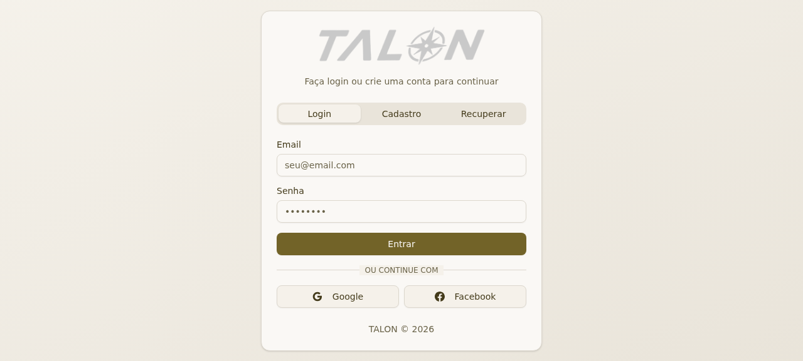
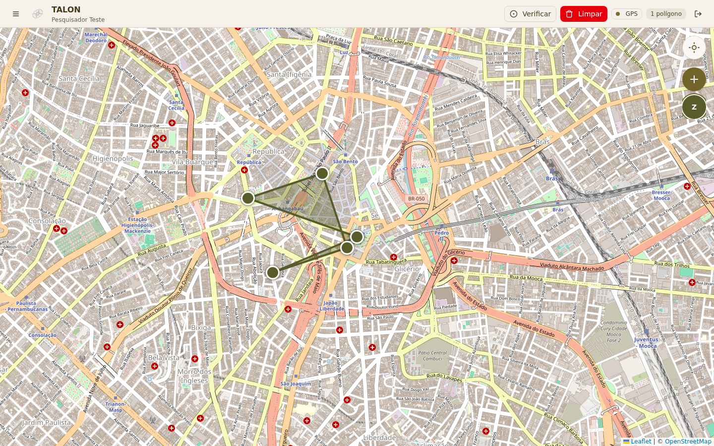
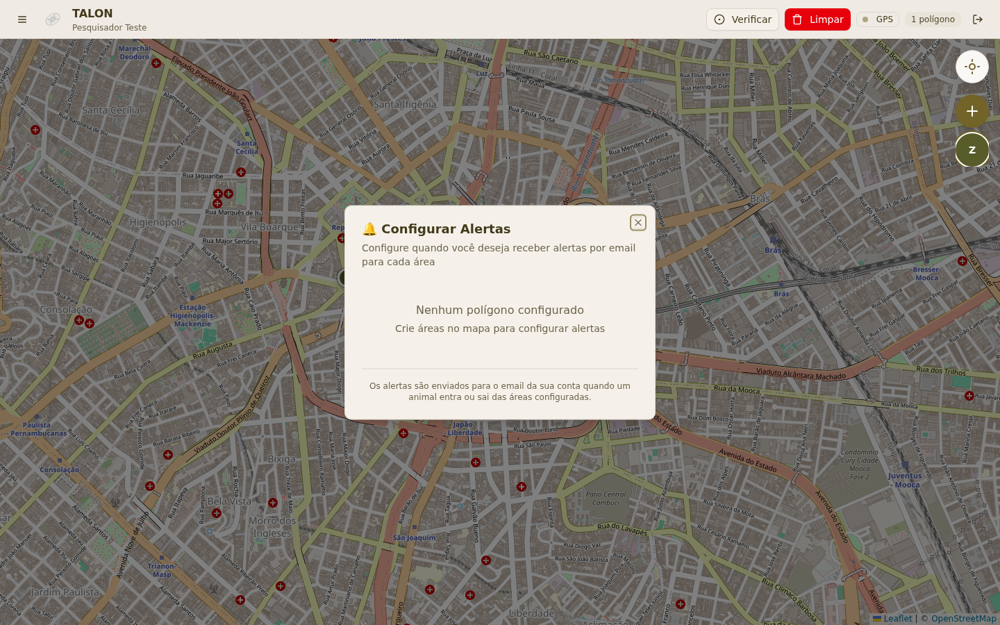

<div align="center">


# TALON

**Rastreamento de fauna em tempo real — do colar GPS ao alerta no seu e-mail**

[](https://nextjs.org)
[](https://react.dev)
[](https://www.espressif.com)
[](https://firebase.google.com)
[](https://www.prisma.io)
[](https://www.typescriptlang.org)

*Trabalho de Conclusão de Curso — sistema completo de monitoramento de animais, com hardware, firmware e software*

</div>

---

**Em uma frase:** um colar de rastreamento (ESP32 + SIM7000G) publica a posição e o nível de bateria do animal no Firebase; a plataforma web deste repositório mostra o animal no mapa em tempo real, permite desenhar **cercas virtuais** (geofencing) em volta de áreas de interesse e envia **alertas por e-mail** sempre que o animal entra ou sai dessas áreas.

O projeto nasceu para resolver um problema clássico do monitoramento de fauna: acompanhar um animal solto na natureza exige horas de observação em campo, geralmente sem garantia de encontrá-lo. Com o TALON, o mesmo trabalho vira uma tela de computador — a posição chega sozinha, a cerca virtual é desenhada com o mouse e o sistema avisa por e-mail quando algo relevante acontece, de dia ou de noite.

| Camada | O que é | Onde está |
|---|---|---|
| **Colar (hardware)** | Placa LilyGo T-SIM7000G: ESP32 + modem SIM7000G + GPS + bateria | No animal (campo) |
| **Firmware (Arduino)** | Código que lê o GPS, mede a bateria e envia os dados | Descrito neste README (seção 4) |
| **Firebase (nuvem)** | Banco em tempo real que conecta colar e plataforma | Google Firebase RTDB |
| **Plataforma web** | Mapa, geofencing, alertas, histórico e heatmap | **Este repositório** (Next.js) |

## Sumário

1. [Sobre o projeto](#1-sobre-o-projeto)
2. [Arquitetura do sistema](#2-arquitetura-do-sistema)
3. [Camada 1 — O colar de rastreamento (hardware)](#3-camada-1--o-colar-de-rastreamento-hardware)
4. [Camada 2 — O firmware, função por função](#4-camada-2--o-firmware-função-por-função)
5. [O Firebase — a ponte entre o colar e a plataforma](#5-o-firebase--a-ponte-entre-o-colar-e-a-plataforma)
6. [Camada 3 — A plataforma web (este repositório)](#6-camada-3--a-plataforma-web-este-repositório)
7. [Como executar o projeto](#7-como-executar-o-projeto)
8. [Guia rápido de uso](#8-guia-rápido-de-uso)
9. [Solução de problemas](#9-solução-de-problemas)
10. [Trabalhos futuros](#10-trabalhos-futuros)
11. [Autores e licença](#11-autores-e-licença)

---

## 1. Sobre o projeto

### 1.1 O problema

Monitorar animais — seja para pesquisa científica, manejo de fauna ou conservação — normalmente exige presença física constante no campo. O pesquisador precisa observar, anotar e torcer para o animal não desaparecer justamente quando a informação é mais valiosa. Equipamentos comerciais de telemetria resolvem isso, mas costumam ser caros, fechados e difíceis de adaptar, o que os coloca fora do alcance da maioria dos projetos acadêmicos e de pequenas instituições no Brasil.

Além do custo, existe o problema do *olhar para o passado*: a maioria das soluções amadoras apenas registra para onde o animal foi. Elas não avisam, no momento em que acontece, que o animal entrou numa área protegida, saiu da reserva ou se aproximou de uma zona de risco. Sem alerta em tempo real, a reação sempre chega atrasada.

### 1.2 A solução

O TALON ataca os dois problemas com uma arquitetura simples e barata de três camadas. O **colar** usa uma placa única (LilyGo T-SIM7000G) que já integra ESP32, modem celular e GPS: a posição é publicada no **Firebase**, e a **plataforma web** transforma esses dados em um mapa vivo. A partir daí, o usuário desenha cercas virtuais sobre o mapa — o sistema de geofencing verifica cada nova posição contra essas cercas e dispara um e-mail quando o animal entra ou sai.

Duas decisões de projeto valem destaque, porque aparecem em todo o resto do sistema:

- **Conectividade dupla.** O colar tenta primeiro o Wi-Fi (rápido e grátis, quando o animal está perto de uma base); sem Wi-Fi, cai automaticamente para o plano de dados do chip celular (GPRS da operadora Claro). O envio nunca depende de uma única rede.
- **Configuração remota.** O intervalo entre envios não é fixo no código: a cada envio bem-sucedido, o colar busca na nuvem o valor atualizado. Mudar de 15 segundos para 1 hora é uma alteração feita na plataforma web — sem religar, sem regravar o firmware no animal.

### 1.3 O que tem neste repositório

Este repositório contém a **plataforma web completa** (aplicação Next.js) e a **documentação do sistema inteiro**. O firmware do colar roda na placa e não vive neste repositório — ele está documentado na [seção 4](#4-camada-2--o-firmware-função-por-função) com o sketch completo, explicado função por função, para que qualquer pessoa consiga reproduzir o colar. Uma demonstração da plataforma está publicada em `talon-beta.vercel.app`.

---

## 2. Arquitetura do sistema

O diagrama abaixo mostra o caminho completo de um dado: do GPS no colar até o e-mail de alerta. Ele é o mapa mental do projeto inteiro — vale voltar aqui sempre que alguma parte parecer desconexa.

```
       NO CAMPO                         NA NUVEM                        NO NAVEGADOR
┌──────────────────┐                ┌──────────────────┐             ┌───────────────────────┐
│      COLAR       │   Wi-Fi (rede  │                  │  onValue    │    PLATAFORMA WEB     │
│   ┌───────────┐  │   disponível)  │                  │ ──────────► │  (Next.js 16)         │
│   │   ESP32   │  │ ─────────────► │    FIREBASE      │             │                       │
│   │  (Wi-Fi + │  │                │       RTDB       │             │  • mapa Leaflet        │
│   │    BT)    │  │   GPRS (chip   │                  │ ◄────────── │  • geofencing         │
│   └───────────┘  │    Claro)      │  /animaisVPJS    │  grava      │  • Prisma + SQLite    │
│   ┌───────────┐  │ ─────────────► │      │           │  usuários   │  • alertas por e-mail │
│   │ SIM7000G  │  │                │  /usuarios/…     │  e cercas   │                       │
│   │ 2G/LTE/GPS│  │ ◄───────────── │      │           │             └───────────┬───────────┘
│   └───────────┘  │  lê intervalo  │                  │                        │
│ bateria (ADC35)  │  (timerVPJS)   └──────────────────┘            e-mail de alerta
└──────────────────┘                                                 ▼
                                                            caixa de entrada do usuário
```

Três propriedades dessa arquitetura merecem explicação:

1. **O Firebase é o ponto único de encontro.** O colar só sabe escrever posições; a plataforma só sabe ler posições. Nenhum dos dois fala diretamente com o outro. Isso significa que adicionar um colar novo não exige mudança na plataforma, e derrubar a plataforma não apaga dados no colar — o Firebase absorve tudo no meio, com atualização em tempo real (qualquer tela aberta vê a posição nova no mesmo segundo).
2. **Cada peça guarda o que é natural para ela.** Dados vivos e de baixo volume (posição, bateria) ficam no Firebase, que é otimizado para sincronização instantânea. Dados estruturais e consultáveis (usuários, cercas com muitos vértices, histórico de alertas) ficam no banco relacional da plataforma (Prisma + SQLite). O e-mail é terceirizado para o EmailJS, que só precisa de chaves de API.
3. **O colar é tolerante a falhas por projeto.** Sem Wi-Fi, usa chip. Sem chip, re-conecta o modem. Sem GPS, continua tentando. Sem configuração na nuvem, assume um intervalo padrão. Em campo, algo sempre falha — o firmware foi escrito para que nenhuma falha individual pare o sistema.

---

## 3. Camada 1 — O colar de rastreamento (hardware)

### 3.1 Componentes

Todo o colar é **uma única placa**: a LilyGo T-SIM7000G. Ela já solda, no mesmo circuito, o microcontrolador e o modem celular — o que reduz pontos de falha, peso e custo de montagem.

| Componente | Papel no sistema |
|---|---|
| **ESP32-WROVER-B** | Microcontrolador com Wi-Fi e Bluetooth; executa o firmware |
| **SIM7000G** | Modem celular 2G (GPRS) e LTE CAT-M/NB-IoT + receptor GNSS (GPS); comunicação com a operadora |
| **Cartão nano-SIM (Claro)** | Plano de dados usado quando não há Wi-Fi (APN `claro.com.br`) |
| **Antena LTE** | Sinal da operadora (voz/dados) — obrigatória para o GPRS funcionar |
| **Antena GPS** | Receptor de posição — precisa enxergar o céu para obter o fix |
| **Bateria 18650** | Alimentação autônoma do colar; a placa tem carregador embutido |
| **LED (GPIO 12)** | "Linguagem de luz" que indica eventos (detalhado na seção 4.5) |

### 3.2 Pinagem

A comunicação entre o ESP32 e o SIM7000G usa uma UART dedicada (`Serial1`), deixando a UART0 livre para o cabo USB — assim o Serial Monitor continua funcionando durante os testes em campo, sem competir com o modem pelos mesmos pinos.

| Nome no sketch | Pino GPIO | Direção (vista do ESP32) | Função |
|---|---|---|---|
| `PIN_TX` | **27** | Saída → SIM7000 | UART1 TX: envia os comandos AT ao modem |
| `PIN_RX` | **26** | Entrada ← SIM7000 | UART1 RX: recebe as respostas do modem |
| `PWR_PIN` | **4** | Saída | Pulso que simula apertar o botão PWRKEY (liga o modem) |
| `LED_PIN` | **12** | Saída | LED de status da placa |
| `BAT_ADC` | **35** | Entrada (pino só-entrada) | Lê o divisor de tensão da bateria (ADC) |
| — | **14** | Saída, fixado em HIGH | Na T-SIM7000G é o SCLK do leitor de microSD; o sketch o deixa em nível definido na inicialização |

Duas escolhas de pinos valem explicação. O **GPIO 35** foi usado porque é um dos pinos *somente-entrada* do ESP32 — ele não pode ser reconfigurado por acidente como saída, e na T-SIM7000G ele já está ligado ao divisor resistivo da bateria, ou seja, é o caminho natural para medir a tensão. O par **26/27** segue o desenho da própria LilyGo: no circuito da placa, o TX do SIM7000G chega no RX do ESP32 (26) e vice-versa, por isso a `Serial1` é aberta com `SerialAT.begin(UART_BAUD, SERIAL_8N1, PIN_RX, PIN_TX)`.

### 3.3 Como o modem é ligado

O SIM7000G não liga sozinho quando a placa recebe energia: ele exige um pulso no pino PWRKEY, como se alguém apertasse o botão de power por um instante. A função `modemPowerOn()` executa a sequência exigida pelo datasheet — um pulso de aproximadamente 1,2 segundo (o mínimo especificado é 1 s):

```
PWR_PIN ─┐LOW(100 ms)──┐HIGH(1,2 s)──┐LOW ───► modem inicia (aguarda 3 s o boot)
```

---

## 4. Camada 2 — O firmware, função por função

O firmware é escrito em C++/Arduino e usa três bibliotecas. A convenção de nomes com o sufixo `VPJS` (identificador do projeto) é mantida nos caminhos do Firebase — `animaisVPJS`, `timerVPJS` — e em componentes da plataforma, como o contexto de autenticação.

| Biblioteca | Autor | Para que serve |
|---|---|---|
| [TinyGSM](https://github.com/vshymanskyy/TinyGSM) | V. Shymanskyy | Converte os comandos AT do modem em funções amigáveis (`gprsConnect`, `getGPS`, …) |
| [Firebase_ESP_Client](https://github.com/mobizt/Firebase-ESP-Client) | Mobizt | Cliente Firebase para ESP32 (leitura e escrita no RTDB) |
| `WiFi.h` (núcleo ESP32) | Espressif | Pilha Wi-Fi embutida do ESP32 |

> **Regra da TinyGSM:** a linha `#define TINY_GSM_MODEM_SIM7000` precisa vir *antes* do `#include <TinyGsmClient.h>` — é ela que compila apenas o código do SIM7000 dentro da biblioteca (que suporta dezenas de modems).

### 4.1 A inicialização (`setup`), passo a passo

1. **Duas seriais, uma janela de cada coisa.** `Serial` (cabo USB) imprime os logs de depuração; `SerialAT` (UART1, pinos 26/27) conversa com o modem. Ambas a 115200 baud.
2. **Pinos de controle.** LED desligado, GPIO 14 em nível alto, `PWR_PIN` pronto para o pulso de ligação.
3. **Modem.** `modem.testAT()` pergunta "você está aí?". Sem resposta, `modemPowerOn()` dá o pulso do PWRKEY (seção 3.3). Depois `modem.init()` e a configuração de rede:
   - `setNetworkMode(2)` — **automático**: o módulo aceita tanto 2G quanto LTE (`AT+CNMP=2`);
   - `setPreferredMode(3)` — aceita tanto **CAT-M quanto NB-IoT**, as duas faixas LTE feitas para IoT (`AT+CMNB=3`).
   Juntas, as duas linhas maximizam a chance de registro na rede, independente do que a operadora disponha na região.
4. **GPS.** `AT+SGPIO=0,4,1,1` liga o GPIO interno nº 4 do SIM7000, que na T-SIM7000G controla a alimentação da antena GPS; `AT+CGNSPWR=1` liga o receptor GNSS em si.
5. **Wi-Fi e Firebase.** `WiFi.begin` entra na rede cadastrada; o cliente Firebase recebe o token legado, o timeout de resposta de 15 s (calibrado para a lentidão do GPRS) e o buffer de resposta de 1 KB (evita JSON cortado). `fbdo.setExternalClient(&gsmClient)` ensina a biblioteca Firebase a usar **o próprio modem como transporte de rede** — é isso que permite enviar dados pelo chip quando o Wi-Fi não existe. `config.cert.data = NULL` dispensa validação de certificado, deixando a conexão mais leve.
6. **Relógio da operadora.** `AT+CLTS=1` faz o modem sincronizar data/hora pela rede celular (útil para os logs).

### 4.2 O laço principal (`loop`) — a árvore de decisão

Cada ciclo do laço segue esta ordem de prioridade — primeiro a posição, depois o melhor transporte disponível:

```
loop()
 ├── modem.getGPS() sem fix ─────────► "Procurando satélites..."
 │      └── reabilita o GPS; se o modem não responder, dá o pulso PWRKEY
 │
 └── getGPS() com fix (latitude + longitude)
        ├── Wi-Fi conectado?                    ──► envia pelo Wi-Fi   ("WIFI ON")
        ├── sem Wi-Fi e sem GPRS conectado      ──► garante modem ligado e chama gprsConnect()
        │                                             (a posição é enviada no ciclo seguinte)
        ├── sem Wi-Fi e com GPRS conectado      ──► envia pelo chip      ("CHIP ON")
        └── nada conectado                      ──► WiFi.reconnect()     ("NADA ON")
                                              └──► dorme (intervalo − 2) segundos e repete
```

Repare que **um ciclo sem rede não é um ciclo perdido**: quando o GPRS ainda não estava conectado, o ciclo se gasta conectando (`gprsConnect`), e a posição acumulada sai no ciclo seguinte. O `delay((intervaloEnvio − 2) * 1000)` desconta os ~2 s que o ciclo levou para trabalhar, mantendo o período total fiel ao intervalo configurado.

### 4.3 As funções auxiliares

**`lerBateria()` — a matemática completa.** A leitura é a média de 10 amostras do ADC (reduz ruído). A tensão é reconstruída em três passos, cada um corrigindo uma característica física do circuito:

```cpp
voltage = (média_10_leituras × 3,3 / 4095)   // 1. ADC de 12 bits (0–4095) com referência de 3,3 V
          × 2,0                              // 2. divisor resistivo da placa: o pino vê METADE da tensão
          × 1,13;                            // 3. calibração empírica da placa (comparada com multímetro)

percent = map(voltage × 100, 365, 420, 0, 100);   // 3,65 V → 0 %   •   4,20 V → 100 %
return constrain(percent, 0, 100);                // trava a faixa (nunca volta 140 % nem −5 %)
```

O `× 100` existe porque a função `map()` do Arduino só aceita inteiros: a tensão vira "centivolts" (3,90 V → 390), caindo na faixa 365–420, que é a janela útil real de uma célula de lítio — abaixo de 3,65 V a bateria está descarregada de verdade; acima de 4,20 V ela está cheia.

**`enviarAoFirebase(lat, lon, bat)` — o pacote.** Monta um JSON com latitude, longitude e bateria, e o publica no nó do animal:

```cpp
json.set("latitude",  lat);
json.set("longitude", lon);
json.set("bateria",   bat);
json.set("timestamp/.sv", "timestamp");   // pede ao GOOGLE para gravar o horário do servidor
Firebase.RTDB.updateNode(&fbdo, "/animaisVPJS/tatu02", &json);
```

O detalhe `timestamp/.sv` é importante: em vez de confiar no relógio do ESP32 (que deriva e não tem fuso garantido), o Firebase grava o horário do próprio servidor Google — todas as posições ficam em linha do tempo confiável. Em caso de erro `connection lost`, o sketch reinicia a sessão do Firebase sem desligar o modem, preservando a conexão GPRS conquistada com esforço.

**`getDelay()` — configuração remota.** Chamada a cada envio bem-sucedido, lê `/usuarios/{uid}/timerVPJS/durationVPJS`. Se a leitura falhar (plataforma fora, por exemplo), o colar não para: assume um intervalo de segurança de 36 s (ou 3.600 s se a flag `isUmaHora` estiver ativa no sketch).

**`gprsConnect()`** espera a rede celular (`waitForNetwork`), conecta ao APN da Claro e imprime o IP público obtido — o IP na tela é a prova de que o chip está de fato na internet, não só com sinal.

### 4.4 Configuração do sketch

Estes são os valores usados no protótipo (animal de teste `tatu02`). Para reproduzir o colar, basta ajustar este bloco — o resto do código não muda:

```cpp
#define FIREBASE_HOST "talon-tcc-project-default-rtdb.firebaseio.com"
#define FIREBASE_AUTH "5DOooaFIE3iSc9iQpEYZnInPu9eQP0USIM24c3df"
#define WIFI_SSID "J.Ga"
#define WIFI_PASSWORD "JJGS4049"

const char apn[]      = "claro.com.br";   // APN da Claro
const char gprsUser[] = "claro";
const char gprsPass[] = "claro";

String uidUsuario  = "LDL9qmv3noQgMnGHWkOrQqGIJjw2";  // dono do timer no Firebase
String nomeAnimal  = "tatu02";                        // nó do animal em /animaisVPJS
bool isUmaHora     = false;                           // fallback do intervalo: 36 s
long long intervaloEnvio = 15;                        // valor inicial, em segundos
```

### 4.5 A linguagem do LED

| Evento | Como o LED pisca | Quando acontece |
|---|---|---|
| Nada a reportar | Apagado | Aguardando o próximo ciclo |
| GPS adquiriu posição | 1 piscada curta (~0,2 s) | `getGPS` obteve latitude/longitude |
| Dado salvo no Firebase | 1 piscada longa (~0,5 s) | Envio confirmado pelo servidor |

Na T-SIM7000G o LED aciona em nível baixo (LOW = aceso), por isso os eventos levam o pino momentaneamente a LOW. Com essa linguagem, quem manuseia o colar em campo consegue diagnosticar o equipamento sem abrir o Serial Monitor: LED apagado significa "aguardando"; piscada curta, "GPS ok"; piscada longa, "dado na nuvem".

---

## 5. O Firebase — a ponte entre o colar e a plataforma

### 5.1 Estrutura do banco

```
talon-tcc-project-default-rtdb
├── animaisVPJS
│   └── tatu02                          ← um nó por animal (nome configurável no sketch)
│       ├── latitude:   -23.550520      ← último fix do GPS
│       ├── longitude:  -46.633308
│       ├── bateria:    87              ← percentual calculado pelo colar (0–100)
│       └── timestamp:  1745…           ← horário gravado pelo SERVIDOR Google (.sv)
│
└── usuarios
    └── LDL9qmv3noQgMnGHWkOrQqGIJjw2    ← usuário dono do colar (UID do Firebase Auth)
        └── timerVPJS
            └── durationVPJS: 15         ← intervalo de envio, em segundos
```

### 5.2 Quem escreve, quem lê

| Caminho | Escrito por | Lido por |
|---|---|---|
| `/animaisVPJS/{animal}` | **Colar** (a cada intervalo) | **Plataforma** (listeners em tempo real) |
| `/usuarios/{uid}/timerVPJS/durationVPJS` | **Plataforma** (tela de configuração) | **Colar** (após cada envio) |

Essa simetria é o que torna o sistema "vivo" nas duas direções: a posição sobe do campo para a nuvem; a configuração desce da nuvem para o campo. O usuário nunca precisa tocar no colar para mudar a frequência de envio — e a plataforma nunca precisa saber quantos colares existem, porque cada um apenas escreve no seu próprio nó.

---

## 6. Camada 3 — A plataforma web (este repositório)

### 6.1 Stack

| Camada | Tecnologia | Papel |
|---|---|---|
| Front-end | Next.js 16 (App Router) + React 19 + TypeScript | Aplicação e páginas |
| UI | Tailwind CSS 4 + shadcn/ui (Radix) | Componentes e visual |
| Mapas | Leaflet + leaflet.heat | Mapa base e heatmap de deslocamento |
| Geometria | geolib | Teste ponto-dentro-de-polígono (o coração do geofencing) |
| Gráficos | Recharts | Painéis de histórico |
| Tempo real | Listeners do Firebase (`onValue`) + Socket.io | Posição nova na tela sem refresh |
| Backend | API Routes (Node runtime) | Sincronização, verificação de cercas, e-mails |
| Banco relacional | Prisma + SQLite | Usuários, cercas, vínculos e alertas |
| Nuvem | Firebase Auth + Realtime Database | Login e dados dos colares |
| E-mail | EmailJS (REST) | Envio dos alertas |

### 6.2 Funcionalidades em telas

Todas as capturas abaixo já estão no repositório (`public/`), então o README renderiza as imagens no GitHub sem configuração adicional.

**Login e autenticação** — contas por e-mail/senha, login social (Google e Facebook) e recuperação de senha, tudo sobre o Firebase Auth. A sessão é compartilhada com o resto do sistema pelo contexto `AuthContextVPJS`.



**Painel (dashboard)** — mapa em tempo real com a posição e a bateria de cada animal. O marcador se move sozinho quando o colar publica um novo ponto.



**Geofencing** — o usuário desenha polígonos diretamente sobre o mapa, escolhe a cor e ativa alertas de *entrada* e/ou *saída* por cerca. A verificação usa `isPointInPolygon` da geolib sobre cada posição nova.


**Alertas por e-mail** — quando uma posição viola uma cerca, a rota `/api/alerts/check` dispara o envio via EmailJS com assunto e corpo já formatados (animal, cerca, tipo de evento, coordenadas e horário).



### 6.3 Estrutura de pastas

```
src/
├── app/
│   ├── page.tsx                 landing page pública (apresenta o projeto)
│   ├── sistema/                 área autenticada (dashboard, mapa, cercas)
│   └── api/
│       ├── users/sync           cria o usuário no Prisma ao logar (vindo do Firebase Auth)
│       ├── animals/sync         vincula usuário ↔ animal (código do colar)
│       ├── polygons/            CRUD das cercas virtuais
│       ├── alerts/check         verifica posições × cercas e dispara e-mails
│       ├── alerts/send          envio manual/externo (redundância)
│       └── simulate-history     gera histórico simulado (demonstrações e testes)
├── components/
│   ├── talon/                   MapView (Leaflet), histórico, config. de alertas, login
│   └── ui/                      shadcn/ui (botões, diálogos, tabelas…)
├── contexts/                    AuthContextVPJS (sessão) + AnimalsContextVPJS (animais)
├── lib/
│   ├── talon/                   firebase.ts, alerts.ts (EmailJS), types.ts
│   └── db.ts                    cliente Prisma (singleton)
├── hooks/                       use-toast, use-mobile
prisma/schema.prisma             modelo de dados (4 tabelas)
public/                          logo, ícones e screenshots
```

### 6.4 Modelo de dados (Prisma)

Quatro tabelas cobrem todo o lado estrutural do sistema. O vínculo usuário↔animal é N:N (uma mesma vaca pode ser monitorada por dois pesquisadores, e um pesquisador acompanha vários animais):

```
User ─1:N─ UserAnimal ─► animalCode (aponta para /animaisVPJS no Firebase)
  │
  └─1:N─ Polygon ─1:N─ Alert   (cada cerca guarda alertas disparados)
```

| Modelo | Guarda | Campos-chave |
|---|---|---|
| `User` | conta do usuário | `email`, `firebaseUid` (ligação com o Firebase Auth) |
| `UserAnimal` | vínculo usuário↔animal | `userId`, `animalCode`, `animalName` (apelido dado pelo usuário) |
| `Polygon` | cerca virtual | `vertices` (JSON de coordenadas), `alertOnEntry`, `alertOnExit`, `isActive` |
| `Alert` | registro de alerta enviado | `type` (`entry`/`exit`), `emailSent`, `sentAt` |

---

## 7. Como executar o projeto

### 7.1 Plataforma web

**Pré-requisitos:** Node.js 20+ (ou Bun 1.1+) e uma conta Firebase com Realtime Database e Authentication ativados.

1. Instale as dependências:

```bash
bun install        # ou: npm install
```

2. Crie o arquivo `.env` na raiz com as variáveis abaixo (valores do console do Firebase, aba Configurações do projeto, e do dashboard do EmailJS):

```env
DATABASE_URL="file:./db/custom.db"

NEXT_PUBLIC_FIREBASE_API_KEY=…
NEXT_PUBLIC_FIREBASE_AUTH_DOMAIN=…
NEXT_PUBLIC_FIREBASE_DATABASE_URL=https://talon-tcc-project-default-rtdb.firebaseio.com
NEXT_PUBLIC_FIREBASE_PROJECT_ID=talon-tcc-project
NEXT_PUBLIC_FIREBASE_STORAGE_BUCKET=…
NEXT_PUBLIC_FIREBASE_MESSAGING_SENDER_ID=…
NEXT_PUBLIC_FIREBASE_APP_ID=…

EMAILJS_SERVICE_ID=…
EMAILJS_TEMPLATE_ID=…
EMAILJS_PUBLIC_KEY=…
EMAILJS_PRIVATE_KEY=…
```

3. Prepare o banco e suba o servidor de desenvolvimento:

```bash
bun run db:generate     # gera o cliente Prisma
bun run db:push         # cria as tabelas no SQLite
bun run dev             # http://localhost:3000
```

### 7.2 Firmware do colar

**Pré-requisitos:** Arduino IDE 2.x com o pacote de placas **esp32** (Espressif) instalado, placa LilyGo T-SIM7000G, antenas LTE e GPS conectadas, nano-SIM com plano de dados e bateria 18650.

1. Pelo Gerenciador de Bibliotecas, instale **TinyGSM** (V. Shymanskyy) e **Firebase Arduino Client** (Mobizt).
2. Selecione a placa: *Tools → Board → esp32 → ESP32 Wrover Module* (PSRAM habilitado).
3. Cole o sketch da [seção 4](#4-camada-2--o-firmware-função-por-função), ajuste o bloco de configuração (rede Wi-Fi, credenciais Firebase, `nomeAnimal`, `uidUsuario`) e faça o upload.
4. Abra o **Serial Monitor a 115200 baud**. Uma sessão saudável mostra, nesta ordem: `--- INICIANDO SISTEMA ---`, o IP obtido da Claro, `GPS Fix!` e `SUCESSO NO FIREBASE!`.

---

## 8. Guia rápido de uso

1. **Crie sua conta** na tela de login (ou entre com Google).
2. **Vincule um animal** informando o código dele no Firebase (ex.: `tatu02`) — é o mesmo `nomeAnimal` gravado no firmware do colar.
3. **Acompanhe no mapa**: o marcador mostra a última posição e o percentual de bateria do colar.
4. **Desenhe uma cerca virtual** sobre a área de interesse e marque se quer alerta na entrada, na saída ou em ambos.
5. **Ajuste o intervalo de envio** na configuração do timer — na próxima transmissão, o colar adota o novo valor sozinho.

---

## 9. Solução de problemas

| Sintoma (Serial Monitor / tela) | Causa provável | O que fazer |
|---|---|---|
| `Falha ao obter IP da Claro` | APN errada, antena LTE fraca ou plano sem dados | Conferir APN `claro.com.br`, antena LTE encaixada, sinal da região e se o chip tem internet ativa |
| `Procurando satélites...` (demora) | Antena GPS sem visão do céu / primeiro fix (partida a frio) | Usar o colar em ambiente aberto; o primeiro fix pode levar alguns minutos |
| `Erro: connection lost` | Sessão do Firebase caiu no meio | O sketch já reinicia a sessão sozinho; se persistir, checar sinal/internet |
| JSON cortado / resposta estranha | Buffer pequeno para o GPRS lento | Já mitigado no sketch: `setResponseSize(1024)` e timeout de 15 s |
| `Modem OFF` repetido | Bateria fraca ou modem travado | O pulso PWRKEY é re-aplicado automaticamente; recarregar a bateria 18650 |
| Bateria sempre em 0 % ou 100 % | Fator de calibração (×1,13) diferente nesta placa | Medir a tensão real com multímetro e ajustar o fator no `lerBateria()` |
| Posição não chega na plataforma | Colar enviando por rede que caiu depois do envio | Observar o LED: piscada longa = dado na nuvem; se faltar, revisar Wi-Fi/chip |

---

## 10. Trabalhos futuros

- **Deep sleep entre envios** — dormir o ESP32 no intervalo (o maior consumo é o modem; acordar só para transmitir multiplicaria a autonomia da bateria).
- **Carregamento solar** — a T-SIM7000G já tem circuito para painel solar, o que eliminaria a manutenção em campo.
- **Regras de segurança do Firebase** — restringir leitura/escrita por usuário autenticado em vez de token legado.
- **Notificações push/PWA** — complementar o e-mail com avisos no navegador e no celular.
- **Buffer offline no microSD** — gravar posições durante apagões de rede e reenviar em lote quando a conexão voltar.

---

## 11. Autores e licença

Projeto desenvolvido como Trabalho de Conclusão de Curso.

- **Firmware e hardware:** Joshua ([@Joshua-likesjs](https://github.com/Joshua-likesjs))
- **Plataforma web:** equipe TALON — [github.com/Joshua-likesjs/TALON](https://github.com/Joshua-likesjs/TALON)

Distribuído sob a licença MIT. Consulte `LICENSE` para detalhes.


